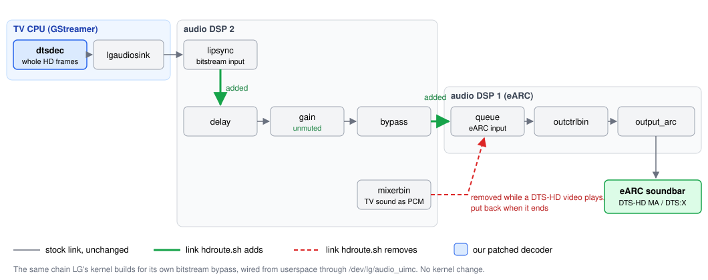
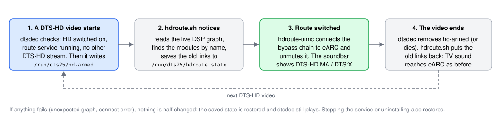

# DTS bitstream passthrough on webOS 25

webOS 25 has no DTS decoder, so `dtsdec` decodes DTS in software. A receiver can
still get the real DTS bitstream in two ways. Both are opt-in in the app.

| Mode | What the receiver gets | Needs |
|---|---|---|
| **Send DTS to a receiver** | the DTS 5.1 core | ARC or eARC, Digital Sound Out on Pass Through or Auto |
| **Full DTS-HD MA / DTS:X** | the whole bitstream, objects included | eARC, plus the mode above |

The core mode is described in the [README](../README.md#send-dts-to-a-receiver-passthrough-opt-in).
This page covers the full DTS-HD mode.

## The problem

LG's audio graph already has a path for an undecoded bitstream: a bypass chain
from the sink to the eARC output. LG's kernel only connects it when LG's own
decoder plays. For our software decoder it never does, so the bitstream has
nowhere to go and the eARC output keeps getting mixed PCM.

## The approach

The DSP modules can be connected from userspace through `/dev/lg/audio_uimc`.
LG's kernel driver accepts that from root
([`allow_nonsecure_connect`](https://github.com/maxdewald/webos25-audio-decomp/blob/acf7f0205ac4b3285058e13c7741facaab9a6fea/src/kernel/aud/module_list.c#L224)).
So while a DTS-HD video plays, a small service builds the same chain LG's kernel
would build, and takes it down again when the video ends. No kernel module, no
kernel patch.

What each part does:

- **`dtsdec`** packs each whole DTS frame into an IEC 61937 type IV burst (the HDMI
  high-bitrate format), using FFmpeg's spdif muxer. It labels the stream with the caps
  LG's own MAT (Dolby Atmos) encoder uses, which have the same data rate. The eARC
  output then accepts it; the soundbar reads the real format from the burst header.
  A frame that does not fit one burst is muted, never cut down to the core.
- **`hdroute.sh`** waits for `dtsdec` to arm, finds the modules in the live DSP graph
  by name, saves the current links, connects the bypass chain to eARC and unmutes it.
  It undoes this when the stream ends, `dtsdec` dies, or the service stops.
- **`hdroute-uimc`** is a small helper that issues the two ioctls: connect and
  disconnect-input.

## Proof

- **Kernel source, reconstructed:** the public
  [webos25-audio-decomp](https://github.com/maxdewald/webos25-audio-decomp) repo
  rebuilds LG's audio kernel driver and DSP code from the C2 firmware, checked against
  LG's GPL source. The parts this relies on:
  - the [connect and disconnect ioctls](https://github.com/maxdewald/webos25-audio-decomp/blob/acf7f0205ac4b3285058e13c7741facaab9a6fea/src/kernel/aud/user_imc.c#L454-L470);
  - [`_get_output_format`](https://github.com/maxdewald/webos25-audio-decomp/blob/acf7f0205ac4b3285058e13c7741facaab9a6fea/src/kernel/aud/alsa_sndout.c#L2127),
    which only picks the bypass for LG's own decoders, so it never routes ours;
  - [`dot_registry`](https://github.com/maxdewald/webos25-audio-decomp/blob/acf7f0205ac4b3285058e13c7741facaab9a6fea/src/libaa/debug.c#L399),
    which prints the live graph `hdroute.sh` reads.
- **Bursts:** `src/test/test-spdif-hd.c` checks every burst against FFmpeg, and that an
  oversized frame is muted instead of stripped to the core.
- **On a TV:** LG C2 (`OLED42C27LA`, webOS 25 10.3.1) with a Denon soundbar over eARC.
  The soundbar showed DTS-HD MA, including a looped clip, a seek, and connecting
  while already playing.

## Limits

- **eARC only.** Plain ARC has no room for the HD bitstream.
- **TV sounds are not mixed in** while a DTS-HD video plays, because the mixer feed
  of eARC is replaced. They come back when the video ends.
- **Lip sync** uses the receiver's own A/V delay setting.
- **One DTS-HD stream at a time.** A second one gets the core mode.
- If the graph does not look as expected, `hdroute.sh` logs it and changes nothing.
  `dtsdec` then sends the core or silence for that video, never noise.
- Log: `/var/lib/webosbrew/dtsenabler/hdroute.log`.

## Other TVs

Nothing in the route is tied to one model: module ids come from the live graph, and
the helper only needs `/dev/lg/audio_uimc`. To check another webOS 25 set, play a
DTS-HD video with the mode on and read the log.

- `routed lipsync_… -> queue_…` and the receiver shows DTS-HD: it works.
- `unexpected graph: …`: that TV's graph differs. Send the log line and the output
  of `echo "2 debug_aimc2 X fcall dot_registry" > /proc/aaudio/callv; dmesg | tail -200`
  (and the same with `1`).
- `connect failed`: that kernel does not allow userspace connects.

Older webOS versions with native DTS (C4/G4/M4/T4) do not need this.

## What stays out of reach

- **DTS decoding on LG's DSP.** The DSP firmware has a `dec_*` module for every codec
  except DTS, so there is nothing to re-enable or port from an older TV.
- **The "DTS:X" badge on the TV speakers.** LG's only object-audio decoder
  (`libgstlgaudiodec.so`) accepts E-AC-3 and AC-4, never DTS or TrueHD. With the full
  DTS-HD mode the receiver renders the objects instead.
- **TrueHD passthrough.** Not supported.
